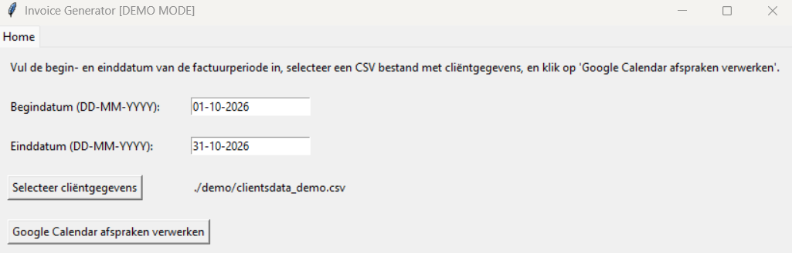
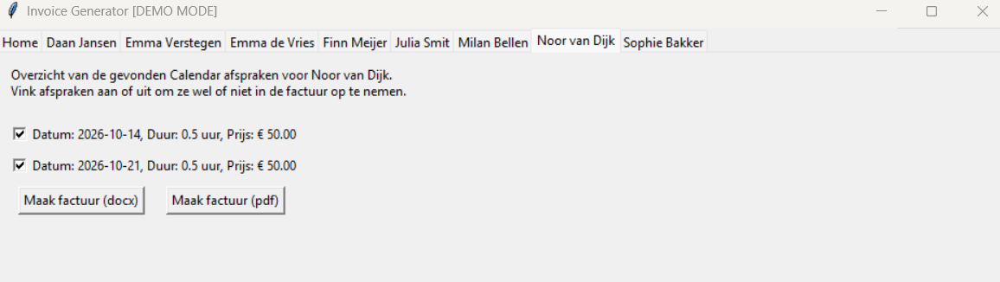
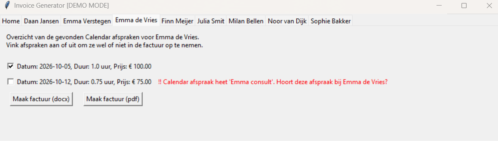

# Invoice Generator — Google Calendar Invoice Generator

A Python desktop application that turns Google Calendar appointments into client invoices. It was originally developed to automate the monthly invoicing workflow of a single professional. This public portfolio version uses **fictional client and business information** and includes an **offline demo mode**.

The application combines Google Calendar API integration, CSV-based client records, appointment-to-client matching, hourly-rate calculations, a Tkinter interface, and DOCX/PDF invoice generation.

## Features

- **Google Calendar integration:** Retrieve appointments for a selected date range using Google's Calendar API and OAuth 2.0.
- **Client database:** Load client names, billing addresses, invoice recipients, identifiers, and hourly rates from CSV (or Excel, where supported by the loader).
- **Appointment matching:** Match event titles against clients using full names or first names; flag ambiguous first-name matches for manual review.
- **Non-billable appointments:** Exclude introductory calls indicated by `bellen`, with an exception and warning for clients whose surname is Bellen (an exception introduced for the intended user's preferred flow).
- **Human review:** Review identified appointments per client, and check or uncheck entries before invoicing.
- **Invoice generation:** Calculate consultation charges from appointment duration and hourly rate; export invoices as DOCX or PDF.
- **Offline demo:** Explore the workflow with fictional clients and mock calendar events, without Google login.

## Screenshots

Home screen:


Individual client tab after processing Calendar events:


Example of a warning message in case multiple clients with the same first name exist:


## Quick start: offline demo

**Requirements:** Windows, Python 3.10+ and pip. PDF conversion on Windows additionally requires an installed copy of Microsoft Word. DOCX export does not require Word.

1. Clone the repository, or download and extract its source code, then open PowerShell in the project folder.
2. Create and activate a virtual environment:

   ```powershell
   py -m venv .venv
   .\.venv\Scripts\Activate.ps1
   ```

3. Install dependencies:

   ```powershell
   python -m pip install -r requirements.txt
   ```

4. Start demo mode:

   ```powershell
   python gui.py --demo
   ```

5. In the GUI, use the fictional client database provided under `demo/` and select **01-10-2026** to **31-10-2026**. Click **Google Calendar afspraken verwerken**, review the matched appointments, then generate an invoice for a client.

Demo mode uses the sample data in `demo/clientsdata_demo.csv` and `demo/mock_calendar.json`. It does not contact the Google Calendar API or request OAuth authorization. The mock events are fixed to October 2026, so selecting a different billing period may yield no appointments.

## Example matching rules

| Calendar event title | Result |
|---|---|
| `Emma de Vries` | Match the full client name |
| `Emma consult` | Match by first name if it is unique |
| `Emma` with two clients named Emma | Flag ambiguous matches for review |
| `Emma bellen` | Exclude as an introductory call, or match with warning if a client named `Emma Bellen` exists in the selected client data file. |

## Running with a real Google Calendar

The original application uses an OAuth 2.0 **Desktop app** client configured in Google Cloud and requests read-only Calendar access (`calendar.readonly`). The browser-based consent flow lets the user authorize their own account; the app stores authorization tokens locally for subsequent runs.

Normal mode requires an OAuth client configuration file named `credentials.json` in the application directory. That file is intentionally not included in the repository for privacy/security reasons. To use normal mode from source, a developer would need to configure a Google Cloud project, enable Google Calendar API, configure the OAuth consent screen, create a Desktop OAuth client, and save its downloaded configuration as `credentials.json`. Google's testing/verification rules may also restrict which users can authorize the application.

## Building an executable

The original single-user application was also packaged for Windows using PyInstaller. The build configuration is not intended as a ready-to-distribute public release for reasons mentioned under [Running with a real Google Calendar](#running-with-a-real-google-calendar). Building the executable therefore does not result in an out-of-the-box runnable app, but instructions are included here just to show that it is possible.

```powershell
python -m pip install pyinstaller
pyinstaller -y gui.spec
```

## Tests

The project uses **pytest** to cover CSV loading, client matching, appointment durations and pricing, demo-date filtering, and DOCX invoice contents.

```powershell
python -m pytest -v
```

## Project structure

```text
.
├── gui.py                  # Tkinter interface and invoice workflow
├── calendar_processor.py   # Calendar API, client matching, DOCX generation
├── pdf_converter.py        # DOCX-to-PDF conversion via Word COM automation
├── util.py                 # Data models, CSV parsing, utility functions
├── constants.py            # Invoice templates and configuration
├── demo/
│   ├── clientsdata_demo.csv
│   ├── mock_calendar.json
│   └── example_invoice.pdf
├── screenshots/
│   └── appointments.png
├── tests/                  # Automated pytest tests
├── requirements.txt
├── pytest.ini
├── gui.spec                # PyInstaller configuration
├── .gitignore
└── README.md
```

## Privacy and limitations

- Developed for a single user's workflow; it is not a multi-tenant billing system.
- All client and business details in the portfolio examples must be fictional. No genuine client database, user token, or private OAuth configuration is intended to be committed.
- The matching logic relies on event-title conventions and requires manual review of ambiguous cases.
- PDF generation on Windows requires Microsoft Word; without it, DOCX output remains available.
- Normal Google Calendar mode requires a separately configured OAuth client; public Google OAuth verification and distribution are outside the scope of this portfolio demo.

## Background

I built this project to replace repetitive manual work: finding appointments, identifying clients, calculating billable time, and preparing invoices. It demonstrates end-to-end automation of a practical workflow, from third-party API data to a document a user can review and save.
